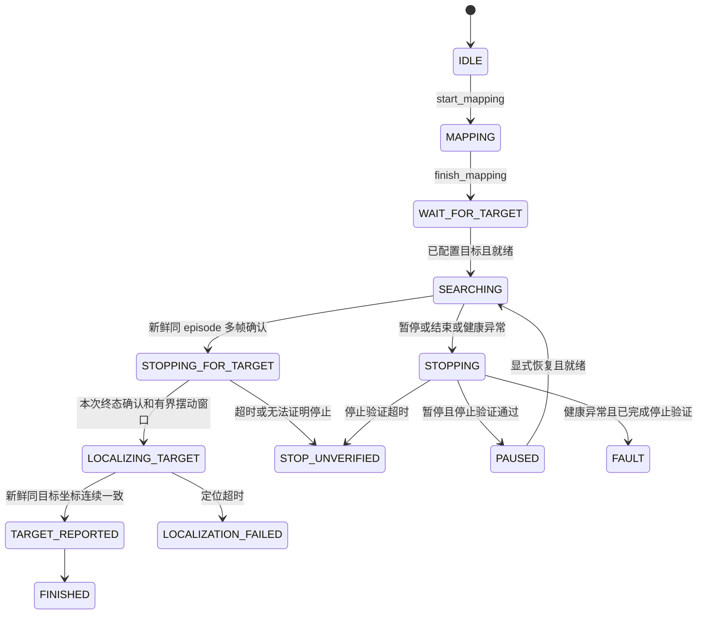

# EE3033：平衡车 YOLO—搜索—停车—定位—上报接线说明

## 0. 给接手 AI 的结论

这是新增的、默认不运动的完整链路**候选实现**，不是实车验收报告。
请先读本文件、AGENTS.md、YOLO_FORMAL_ADAPTER_HANDOFF.md、
STAMPED_LOCALIZATION_HANDOFF.md。保留队友已验收的 NCNN JSON 输入和相机时间戳修复。
不要改教师底盘/相机/Nav2/YOLO 包，不要把外观 similarity 当 YOLO confidence。
不要启动旧 full_runtime 与本入口并行；不要并行运行两个任务管理器或搜索器。

开发基于 2026-11-04 GitHub robot-validation-hardening 的源文件，包含
692e58f 的 stamped localization，以及后续两次 JSON/验收记录更新。
COMPLETE_INTEGRATION_BASELINE.json 记录关键依赖的 Git blob SHA；先验证兼容性，
有 CHANGED 则停下来比较，不覆盖新提交。代码包只有新增文件，不替换旧文件。

已完成作者侧验证：31 项纯 Python 单元/方法测试；语法编译。
方法测试通过 AST 加载真实方法和 test doubles，**不等于 ROS 节点/DDS/Action 测试**。
本作者环境没有 ROS，不能宣称 colcon、ROS 启动、整库 pytest 或实车已通过。
本次没有发布导航目标、没有连接或驱动机器人、没有替用户提交 GitHub。

## 1. 为什么不是“完全静止”

两轮平衡车需要持续调节，瞬时非零速度不代表正在持续行驶。
但速度正负平均接近零也不能证明安全：来回快速摆动仍可能模糊图像。
本实现将两件事独立判断：

1. **软件导航终结**：本进程拥有的目标收到远端 SUCCEEDED/CANCELED/ABORTED，
   或明确拒绝而未执行。cancel 服务应答、本地超时和未来对象完成均不能代替远端终结。
2. **有界观察窗口**：终结后重新采集一段新鲜 odom，检查位置包络、解包裹后的
   yaw 包络、线/角速度 RMS 与峰值、采样数量/间隔/时间戳。

因此不要求 vx=0/wz=0，也不把“我看车没动”转成任意放宽阈值。
输出 BOUNDED_BALANCING_WINDOW 的意思是“在配置的有界摆动范围内”，
不是物理零速、不是急停认证、也不是相机外参正确的证明。

YAML 里的 1.5 s、6 cm、0.15 rad、0.06 m/s RMS 等只是**未验收初值**。
limits_verified 默认 false。需要现场记录扶稳/平衡/缓慢持续移动/转动的样本，
联合设定既能接受正常平衡又能拒绝真实移动的界限。不得为了通过而调大。
odom 的数值还需与实物运动对应；若编码器/协议或 odom 漂移异常，应修数据源。

平衡车 pitch 尤其重要：定位仍按原始图像时间查询 map→真实 optical frame 的完整 TF。
若 TF 只有固定 base_footprint→camera、没有实际车体俯仰，就不能认为已经补偿。
dynamic_camera_tf_verified 默认 false，未验证时不能正式上报。
本包不擅自叠加 IMU pitch，避免与已有动态 TF 重复旋转；需要现场确认 TF/IMU
坐标系、时间同步和外参后，修正真正的 TF 来源或明确设计独立融合。

## 2. 新增文件

| 文件 | 功能 |
| --- | --- |
| balance_observation_gate.py | 有界摆动窗口、远端终态判定、最终坐标边界检查；无 ROS 依赖 |
| continuous_observation_adapter.py | 复用队友 adapter 的两种输入，确认后在停车/定位状态继续输出新鲜观测 |
| guarded_search_manager.py | 继承现有 MLP 搜索；短时租约、迟到规划回调门控、停止握手、超时锁存 |
| target_mission_coordinator.py | 任务状态、目标 episode、停车/定位超时、正式上报、暂停恢复 |
| yolo_complete_validation.launch.py | 新入口，只启动四个本项目节点；不启动硬件栈 |
| yolo_complete_validation.yaml | 全部验证开关、话题和摆动限制，默认不运动 |
| 三个新增 test 文件 | 31 项离线测试，包含状态机方法测试，非 DDS 集成 |
| verify_complete_integration_baseline.py | 只读校验关键旧文件是否仍与开发基线相同 |

setup.py 已自动收集 Python 包、launch/*.launch.py、config/*.yaml。
故新入口使用 /usr/bin/python3 -m，不需要覆盖队友刚修改的 setup.py。
原始 full_runtime、target_checker、target_localizer 不变，可做旧版本回退。
本入口改用 stamped_target_localizer，不依赖旧 Balance TargetInfo 链路。

## 3. 状态图与条件



TARGET_DETECTED 是立即记录的短暂事件，随后立即进入 STOPPING_FOR_TARGET，
不能等定位结果再取消导航。其他 STOPPING 目的对应 FINISHED、SEARCH_EXHAUSTED、
OPERATOR_STOPPED、MISSION_TIMEOUT；SEARCH_EXHAUSTED 表示策略结束/预算用完，
不等于已经识别到目标，更不等于物体不存在。

| 转换/动作 | 实际判定 |
| --- | --- |
| start_mapping | 仅 IDLE/WAIT_FOR_TARGET；只是任务阶段，不启动探索程序 |
| finish_mapping | 仅 MAPPING；操作者确认外部地图保存/定位，不自动保存地图 |
| set_class | 复用真正 SetTargetClass；WAIT_FOR_TARGET、模型类别表、几何和新鲜源检查 |
| start_search | WAIT_FOR_TARGET、非空配置 episode、adapter 心跳、搜索器就绪/无活动导航、摆动参数已验证 |
| 检测触发停车 | confirmed、当前 episode/类别、阈值、原图时间新鲜 |
| 进入定位 | 本次 stop_token 回显、远端目标终结且无其他活动目标、终结后新窗口通过 |
| 正式上报 | LOCALIZING_TARGET、新窗口仍通过、动态相机姿态已验证、同 episode/类别/map、源时间在定位入口之后、有效有限坐标、协方差合法、连续三帧一致 |
| pause | 先 STOPPING，请求取消后验证；服务 success 只表示受理，不等于 PAUSED |
| resume | 仅已验证 PAUSED；源/机器人仍就绪，保留本轮导航次数和总时限 |
| operator cancel | 原 /search/cancel_navigation 仍锁存；不会用 resume 悄悄清除 |
| 本地动作超时 | 锁存 REMOTE_TERMINAL_UNKNOWN，不继续派发；不能用 reset 绕过 |
| reset | 只在允许的非运行状态且本次停止已验证；IDLE 后另行 reset_memory/reconfigure |

各状态不会擅自启用 navigation_enabled。默认 false，只做选点。
launch 强制 single_goal_mode=true/max_navigation_goals=1/return_home_enabled=false。
首次实机验收前不放开连续搜索，不加入自动靠近或返航。

## 4. 数据与控制接口

| 输入/输出 | 类型 | 说明 |
| --- | --- | --- |
| /target/observation | TargetObservation，BEST_EFFORT+volatile+depth 1 | 带原图时间/optical frame/episode；bearing 不是 map yaw |
| /target/estimate_candidate | TargetEstimate，BEST_EFFORT+volatile+depth 1 | 定位候选，不可当最终坐标 |
| /target/configuration | String JSON | adapter 的 episode/类别配置，沿用现有契约 |
| /target/adapter_status | String | 周期源健康；不依赖单条缓存 READY |
| /mission/state | String，可靠+transient local | 给 RViz/adapter 的状态，不是搜索器运动授权源 |
| /mission/lease | String JSON，BEST_EFFORT+volatile+depth 1 | boot、原时钟 stamp、episode、state、stop_token，0.1 s 续约；丢失会 fail closed |
| /search/runtime_state | String JSON，BEST_EFFORT+volatile+depth 1 | 搜索器 boot、任务 boot 回显、本次停止 token、终态、就绪/次数 |
| /mission/diagnostics | String JSON | 摆动原因/各测量值/验证开关/心跳状态 |
| /odom | Odometry，BEST_EFFORT+volatile+depth 1 订阅 | 当前已观察到 odom_combined；丢帧由 motion gap 检查 fail closed |
| /target/estimate | TargetEstimate，可靠+transient local | 只有通过最终边界才发布 valid=true |
| /target_position | PointStamped，可靠+transient local | 最终兼容输出；消费者必须同时核对带 episode 的 estimate |
| /target_found | Bool，可靠+transient local | 本实现含义为“最终坐标已上报”，不是单帧检测事件 |

完整 lease/ack 是本次新增内部契约，不是声称原仓库早已存在。
String JSON 用于不改已生成接口包的控制协议；后续可版本化为独立 typed 消息。
它不是身份认证/安全 PLC；同 ROS domain 的其他程序不得伪造状态或并发控制。
不要手动向 /mission/lease 发布 SEARCHING 来“测试通过”。

新实现订阅相同服务路径 /mission/*；必须确保旧 mission_manager 已停。
/target/set_class、/target/reset 由新 adapter 包装器继承提供。
/search/cancel_navigation、memory 服务由 guarded_search_manager 继承提供。
旧 /target_position 仍可能给新订阅者重放上一任务坐标；必须以 episode 匹配的
/target/estimate 为权威结果，不可仅见 PointStamped 就算本轮成功。

## 5. 基线校验、离线测试与构建

Ubuntu 开发终端（不是树莓派 host Python 3.13）：

```bash
source ~/start_ee3033.sh
cd ~/ee3033_ws/src/ee3033_search_policy
/usr/bin/python3 scripts/verify_complete_integration_baseline.py
/usr/bin/python3 -m compileall -q ee3033_search_policy launch test
/usr/bin/python3 -m pytest test/test_balance_observation_gate.py test/test_complete_mission_protocol.py test/test_continuous_observation_session.py -q
/usr/bin/python3 -m pytest test -q
```

预期：基线全 MATCH，编译退出 0，新测试 31 passed；完整测试以实际输出为准，
不要把历史 158 与新增 31 简单相加当当前整库结果（队友已增加其他测试）。
基线 changed 时比较差异后再集成，不重置别人的提交。

Pi Docker 构建终端（先确认是 root@balance:/，不是 balance@balance15）：

```bash
source /opt/ros/humble/setup.bash
cd /home/ros2_ws
colcon build --base-paths /home/ros2_ws/src/ee3033-search-policy/interface_packages/ee3033_search_policy_interfaces --packages-select ee3033_search_policy_interfaces --symlink-install --cmake-args -DPython3_EXECUTABLE=/usr/bin/python3
source /home/ros2_ws/install/setup.bash
colcon build --packages-select ee3033_search_policy --symlink-install
source /home/ros2_ws/install/setup.bash
ros2 launch ee3033_search_policy yolo_complete_validation.launch.py --show-args
```

不要安装依赖或删除 build/install 来掩盖错误；遇到 symlink/目录冲突，先只备份
对应包的路径。接口包只发现/构建一份，已有 sibling symlink 时不要重复目录。
所有进程需要相同新接口包（包含 bearing_rad），不能混用旧消息类型。

## 6. 机器人 AI 必须完成的只读检查

先记录 git status/branch/full SHA、地图名/hash、模型 hash、环境/domain/RMW。
检查旧策略/旧 adapter 是否正在运行，停止/更换它们要先征得现场同意。
确认没有 explore_lite、waypoint loop、GUI 或其他客户端会同时发导航。

```bash
ros2 node list
ros2 topic list -t
ros2 topic info /odom --verbose
ros2 topic info /camera_info --verbose
ros2 topic info /camera/image_raw --verbose
ros2 topic info /yolo/detections --verbose
ros2 action info /navigate_to_pose
ros2 lifecycle get /planner_server
ros2 lifecycle get /controller_server
timeout 6 ros2 run tf2_ros tf2_echo map base_footprint
```

另检查 map→图像 header.frame_id 的 TF。default_cam 只是已观察到的 frame 名，
不能凭名称认定 +x右/+y下/+z前的 optical convention 已经正确。
相机标定是 raw640x480，不能使用 alpha0 校正后内参计算 raw bbox。

队友已验收相机修复位于 Pi 外部隔离工作区
/home/ros2_ws/usb_cam_timestamp_test.hZhIXi。
仅 pull 此仓库不会安装或启用该修复；完整复用方法见 YOLO_FORMAL_ADAPTER_HANDOFF.md。
必须保留原始图像时间，不能用接收时间替换或放宽 freshness 来绕过驱动 bug。

已观察到的 NCNN 输入：/yolo/detections 是 String JSON，
图像 /camera/image_raw，相机内参 /camera_info；不要误订成 DetectionArray。
adapter input_format=ncnn_json。使用其他 YOLO 时先验证真实类型再选择 detection_array。
模型类别表从实际部署模型导出；旧 /tmp/ee3033_yolo_labels_520cpu0n.json
可能已消失，不能凭示例伪造只含 bottle 的正式类别表。

## 7. 准备现场参数（不自动放开）

经同意复制为本地试验配置，保留默认文件：

```bash
cd /home/ros2_ws/src/ee3033-search-policy
cp -n config/yolo_complete_validation.yaml config/yolo_complete_robot_LOCAL.yaml
```

由 AI 和现场操作员逐项填写/验证：

- adapter：input_format、实际 topics、geometry_verified。
- localizer：实际 CameraInfo、geometry_verified；只有物体确在已知地面才启用
  assume_ground_contact。桌面/架上物体不能套 z=0 地面接触点。
- search：exclusive_navigation_verified（确保没有其他导航控制者）、
  robot_geometry_verified（map/TF/脚印/clearance/定位/传感器都已实核）。
- coordinator：odom_frame、limits_verified、dynamic_camera_tf_verified。
- 验证场地坐标与相机姿态，记录实际限值选择依据，不把所有 verified 批量设 true。

使用原 TF 的实时姿态，地面投影可在有界摆动中计算，不需要机械零速。
如果 TF 没有实际 pitch 或目标接地点被遮挡，保持定位无效，而不是发一个猜测坐标。

## 8. 首先只做不运动联调

前提：新代码已构建，配置/真实 labels 路径存在，旧重复节点已获准停止。
基础栈和相机/YOLO 按各自已验收流程运行，不由本 launch 擅自重启。
以下例子的 labels 变量必须先设为**已核实的真实模型 JSON 路径**。

```bash
source /home/ros2_ws/install/setup.bash
test -f "$LABELS_FILE" || echo 'STOP: set LABELS_FILE to the verified model label JSON'
```

仅文件已确认存在后启动，并保持该终端运行：

```bash
ros2 launch ee3033_search_policy yolo_complete_validation.launch.py params_file:=/home/ros2_ws/src/ee3033-search-policy/config/yolo_complete_robot_LOCAL.yaml labels_file:="$LABELS_FILE" navigation_enabled:=false
```

新控制终端（同 Pi Docker）：

```bash
source /home/ros2_ws/install/setup.bash
timeout 5 ros2 topic echo /mission/state --once --qos-durability transient_local
timeout 5 ros2 topic echo /search/runtime_state --once \
  --qos-durability volatile --qos-reliability best_effort
timeout 5 ros2 topic echo /mission/diagnostics --once --qos-durability transient_local
```

初始应 IDLE；默认未验证的配置会显式拒绝开始任务，这是预期，不是卡死。
只有上节现场证据完成、服务各次 success=True 才依次调用（已有图时只是确认阶段）：

```bash
ros2 service call /mission/start_mapping std_srvs/srv/Trigger '{}'
ros2 service call /mission/finish_mapping std_srvs/srv/Trigger '{}'
ros2 service call /target/set_class ee3033_search_policy_interfaces/srv/SetTargetClass "{class_name: bottle, min_confidence: 0.65}"
```

记录新的 episode；bottle 可换实际模型支持的类别。若不支持，应拒绝，不猜 ID。
start_search 前核对 /search/runtime_state 的 ready、quiescent 和 navigation_enabled=false。

```bash
ros2 service call /mission/start_search std_srvs/srv/Trigger '{}'
```

这次保持 navigation_enabled=false：MLP 只选点，摆放目标可验证检测→停车握手
（本进程从未派发导航）→窗口→定位→上报。这个结果**不算运动中取消验收**。
若目标不在地面且没有足够多视角基线，LOCALIZATION_FAILED 是正确结果，
不应该自动朝 bearing 开过去。默认三帧正式坐标输出需来自 LOCALIZING_TARGET
之后的新图像，不用确认前或上一任务缓存坐标。

## 9. 必测负例与后续实机顺序

至少记录以下证据：

1. 无目标、错误类别、低分、重复帧、旧 episode 均不能触发正式上报。
2. 仅 cancel ack、仍执行、本地超时、旧 stop_token 均不能进入定位。
3. 正常小幅平衡通过；持续平移、明显转动、odom断流/重放拒绝。
4. 光学 TF 缺失、过期、pitch未验证、标定不符、错误地面假设不得伪报坐标。
5. pause/resume 保持预算；operator cancel 不能被 resume 清锁。
6. 检测器/协调器断流时搜索器取消并禁止派发；重连不自动恢复。
7. 一轮任务重配后，旧 observation/estimate 不能污染新 episode。
8. 最终坐标与人工量测真值比较，记录误差和失败率，不能只看 valid=true。

上述无运动通过后，现场明确授权才允许一次短导航：
物理急停就绪、清空场地、仍 single_goal=1、返航关闭。
必须分别验收正常到达、运动中发现目标取消、操作员取消、传感器断流。
核对本次 goal UUID、远端终态、窗口、现场停止，不能把 budget完成当取消通过。
这里不提供自动 navigation_enabled=true 命令，避免把导入代码误当运动授权。

## 10. 已知边界，不能对组员宣称“全部实车完成”

- 新 wrapper/launch 的真实 ROS 初始化、参数、消息/QoS/Action 回调尚需本地 ROS
  与 Pi 无运动验收；31 项离线方法测试没有覆盖这些运行依赖。
- 进程内 timeout/unknown 锁存不会因 reset 清除；未知远端状态只能先人工确认
  Nav2/实际停止，再审查重启恢复。进程/主机重启并不保存安全认证或导航预算。
- 旧 Nav2Client 在 close 时最多尽力取消；Ctrl+C、断网、杀进程/整机故障不能
  保证物理停止。需要底盘级 watchdog/急停等独立措施，软件本包不能替代。
- 该入口不启动自主建图、不保存地图、不自动切换 SLAM/AMCL、不驱动蜂鸣器。
  mapping 两个服务是阶段确认，不冒充上述硬件集成已实现。
- 不自动靠近、不主动制造三角测量基线、不自动返航。仅 bearing 没有安全距离，
  不直接前进固定距离；以后需有效坐标/不确定度、障碍成本图和独立运动预算。
- stamped localizer 保留地面/多视角方法；没有把旧 LiDAR 融合冒充已移植完成。
  低物体未被雷达照到时不能用后墙距离；不可靠时明确定位失败。
- 无 tracking_id 时同类别多物体可能串目标；IoU/坐标一致性不是实例身份认证。
- 协方差/quality 沿用候选算法的启发式，不是实测标定后的误差置信概率。
- 窗口与路径/转角观测门限要现场确认；覆盖仍是可见性模型记忆，
  有图像源心跳不等于物体检测范围内每格都真实看清。

## 11. 提交、回退与团队交接

本包新增文件不会覆盖 AGENTS.md。附带只追加说明的补丁，先检查再应用：

```bash
git apply --check AGENTS_COMPLETE_WORKFLOW.patch
git apply AGENTS_COMPLETE_WORKFLOW.patch
```

若检查失败，停下来比较 AGENTS.md 的新改动，不强行覆盖。
该补丁保留原说明；不要让 AI 只看旧 full_runtime 就启用运动。
通过本机/机器人各自测试后再 git add 精确文件并提交本分支。
不要 git add .；保留 report_assets/、TEST_ONLY labels、地图和队友修改不动。
不要合并 main 或 force push。遇到远端更新先 fetch/比较，再快进或审查合并。

回退：在现场停止与远端终态确认后，只停止这四个新进程；选择旧入口前明确
旧入口不具备本次所有门控。不要删除地图/权重/相机隔离工作区来回退。

完整验收日志至少包含 SHA、地图与模型 hash、相机驱动前缀、真实 topic/type/QoS、
episode、stop_token、goal UUID/终态、摆动窗口指标、使用的姿态/定位方法、
估计坐标/真值/误差、所有拒绝原因。未测项写未测，不从历史通过推断。
